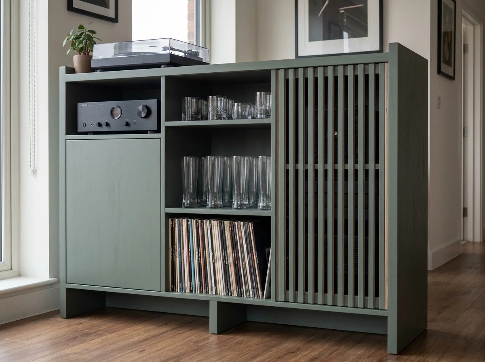
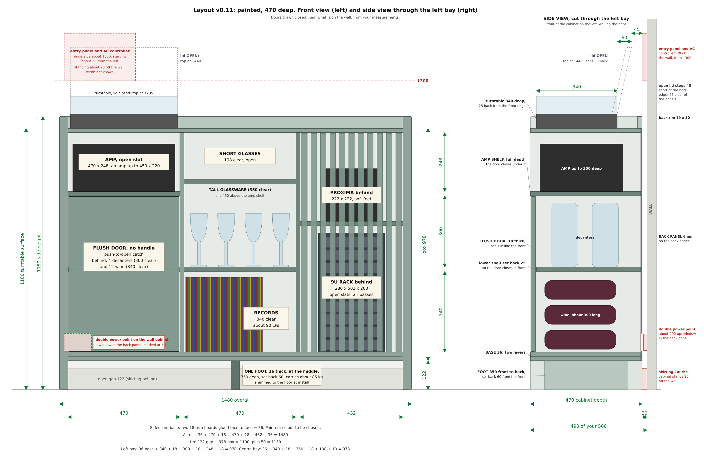
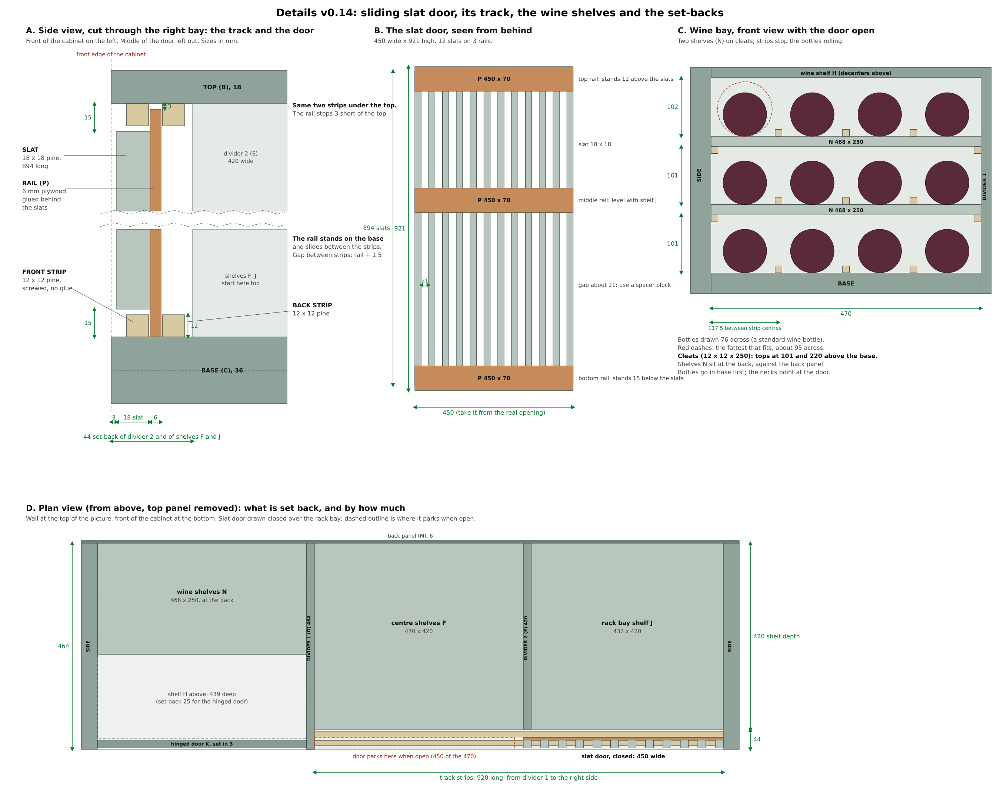

# record-player-console

A painted plywood console for a turntable, records, wine, whisky decanters and glassware. It also houses a 9U 10-inch mini rack and a small Proxmox server (Proxima, in a Jonsbo N2) behind a sliding slatted door. This is a first woodworking build, planned so that a cut-to-size supplier makes every long cut.

## Status

**Design v0.14: settled. The build is parked until early 2027; milestone 2 (get a cut-to-size quote) is the next step.** Nothing has been ordered. Two small parts (J and L) get their final size from the board thickness the supplier quotes, so the order waits for the quote.

v0.14 added the wine shelves, the sliding slat door and its track, and changed the cut list: parts E, F and J are 420 wide (they were 434), and parts N and P are new. **A quote request saved from v0.13 is out of date.**

## The design at a glance

| | |
|---|---|
| Overall size | 1480 wide × 1150 high × 470 deep (stands 20 off the wall on the skirting) |
| Turntable surface | 1100 (Akai AP-B21, far left, lid opens to 1440) |
| Material | 18 mm paint-grade interior plywood (birch B/BB preferred), 6 mm plywood back; dressed pine for the slats and strips |
| Construction | Pocket-hole screws plus glue; sides and base doubled to 36 mm; one central foot under the base |
| Finish | One matt water-based enamel colour inside and out, to start |
| Left bay (470) | Open amp slot on top; inset push-to-open door over 4 decanters and 12 wine bottles in three rows, on two shelves resting on cleats |
| Centre bay (470) | Open: short glasses, tall glassware, about 90 LPs. Shelves set back 44 for the slat door |
| Right bay (432) | Behind the sliding slat door: 9U rack on the bottom, Proxima on a shelf above |
| Slat door | Twelve 18 × 18 pine slats glued to three 6 mm plywood rails, sliding between screwed-on 12 × 12 pine strips. No routed groove |
| Speakers | Outside the cabinet, to avoid feedback through the turntable |
| Rough budget | About AU$800–1,200 all in (estimate; the quote will replace it) |

## Documents

| File | What it is |
|---|---|
| [docs/design-brief.md](docs/design-brief.md) | The full plan: layout, reasoning, material, paint, joinery, cut list, quote step, milestones M1–M11, safety notes, lab notebook and sources |
| [docs/cut-list.csv](docs/cut-list.csv) | The cut list as a table a supplier's software can import, with the 17 mm variants of J and L (v0.14) |
| [docs/quote-request.txt](docs/quote-request.txt) | A ready-to-send quote request (v0.14, 23 parts). Fill in `[SUBURB]` and `[NAME]` |
| [docs/drawings/](docs/drawings/) | Current drawings: front and side views (v0.11), details of the slat door, track, wine shelves and set-backs (v0.14), cutting layout on three sheets (v0.14) and the doors-open view (v0.6). `history/` has the earlier layouts |

## Milestones

| # | Goal | Status |
|---|---|---|
| M1, M1b, M1c | Mock up the height, measure the turntable lid, glassware and wall fittings | Done 2026-11-25 |
| M2 | Get a written cut-to-size quote (board, real thickness, sheet size, total, lead time) | Next, in early 2027 |
| M3 | Set J and L from the quoted thickness, order, check and label the parts | |
| M4 | Practice pocket-hole corner and paint test on offcuts | |
| M5 | Glue the doubled sides and base, round over the edges with a sanding block and fill them, drill pocket holes | |
| M6 | Glue and screw the carcass | |
| M7 | Back panel and cut-outs, shelves set from the real rack and glasses, foot | |
| M7b | Wine shelves: cleats, two shelves, separator strips | |
| M8 | Fill, prime, two top coats, one week to harden | |
| M9 | Inset door | |
| M10a | Build and paint the slat door on the bench | |
| M10b | Fit the strip track and hang the door | |
| M11 | Install, shim the foot, anti-tip strap, load, hum and drive-temperature checks | |

Each milestone's success check and "if it doesn't work" notes are in section 9 of the brief.

## Safety

The finished cabinet is about 65 kg empty and 180 kg or more loaded, and 1150 high. Fix it to the wall with an anti-tip strap before loading it. No mains wiring is built in: a certified power board with overload protection does the job, and the wall power point is not touched. Section 10 of the brief covers tools, dust and paint.
