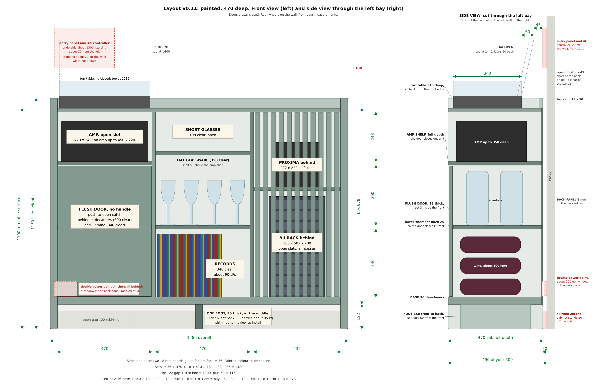
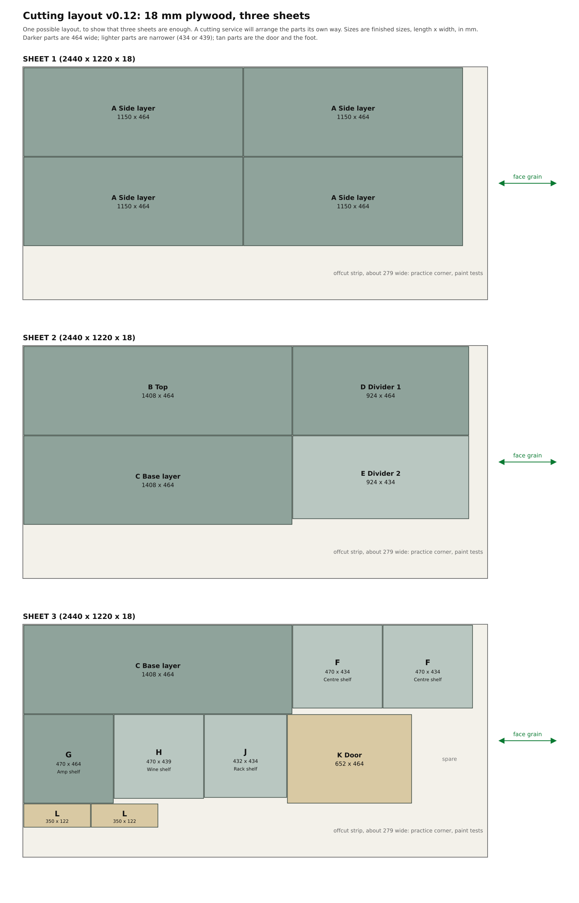

# Record console: design brief v0.13

> Source of truth while the design is in progress: the `design-brief` document on Paperclip task GLE-185. This file is a snapshot of revision v0.13 (2026-11-25).

**Status:** the board is plywood, the depth is 470, the paint starts as one matt colour, and a plywood supplier will cut every part (your choice). Open: the quote. Section 8 has a request you can paste into an email or a supplier's quote form. **Nothing should be ordered yet:** two small parts get their final size from the board thickness the supplier quotes.



The front and side views are unchanged from v0.11: plywood changes no dimension on them. The front view is drawn with the doors closed. The side view is cut through the left bay. Red marks are the wall fittings from your measurements. The colour is a placeholder. The v0.6 drawing with the doors open still shows what sits behind them: [Console front elevation v0.6](drawings/console-v0.6-doors-open.png). Earlier drawings: [v0.10](drawings/history/console-elevation-v0.10.png) (timber finish, 405 deep), [v0.9-L](drawings/history/console-elevation-v0.9-L.png) (plinth), [v0.9-R](drawings/history/console-elevation-v0.9-R.png) (mirrored, not chosen) and [v0.8-B](drawings/history/console-elevation-v0.8-B.png) (legs and low shelf, not chosen).

## 1. What changed, and why

### v0.13: the supplier route is chosen, and one correction

You chose the supplier route, with no changes to the cut list. Two things changed in the brief:

* **A quote request is written out** in section 8, with the cut list as plain text below it. Fill in your suburb and send it.
* **I corrected the 17 mm claim.** v0.12 said no part changes size if the board is 17 mm. That was wrong for two small parts, the rack bay shelf (J) and the foot layers (L). The details are under "Thickness" below. The request asks the supplier for the real thickness, and I set those two parts from the answer before you order.

### v0.12: plywood, 470 deep, cut by a supplier

Your answers: plywood; 470 is the cabinet's own depth; you would rather the store made the cuts; and the paint starts as one colour in a matt sheen, to be experimented with after the build.

### Who cuts the parts

A hardware store's saw can't make these parts. Its cutting service exists to get sheets into a car: the store's own page says it is not for precision [29], one staff answer gives 5 to 10 mm as the accuracy on plywood, and another describes cuts only in 100 mm steps with a 600 minimum [31]. This cabinet needs matching parts within about half a millimetre of each other.

A plywood supplier with a cut-to-size service can. They cut on a panel saw or beam saw, which holds a sheet flat against a fence and cuts it square. One Australian supplier publishes plus or minus 1 mm as its tolerance, quotes each job, sells whole sheets only, returns the offcuts, delivers, and gives about 14 business days as its lead time [32]. I use it as an example of how these services work. I don't know where you are or which suppliers are near you.

| Route | Accuracy | What you still cut | Cost |
|---|---|---|---|
| **Supplier cuts every part to the list (recommended)** | About 1 mm, and matching parts match | The back panel's cut-outs and the lead hole | Board plus a cutting and delivery charge, by quote |
| Hardware store cuts the sheets into strips for the car | 5 to 10 mm | Every final cut, including the long ones | A few dollars |
| A local cabinetmaker or joinery shop cuts your sheets | About 1 mm | As the first row | By quote |

You chose the first route. It removes the hardest and riskiest step for a first build, which is making long, straight, matching cuts with a hand-held saw. Its costs are a wait of two or three weeks and a charge I can't estimate.

**Why matching matters more than exact size.** If both side layers are 1151 the cabinet is 1 mm taller and nobody can tell. If one is 1150 and the other 1152, the top doesn't sit flat. A panel saw cuts all parts of one size against the same stop, so they match.

Section 7 has the cut list in the form a supplier needs, and section 8 has what to ask for.

### Plywood: what it changes

* **Stiffness.** Plywood is about three times as stiff as MDF along its face grain. The base figures are below.
* **Joinery.** The support strips from v0.11 are dropped. They were there because screws hold poorly in MDF, and plywood holds screws well [26]. The practice corner still tests this before anything is glued.
* **Weight.** The empty cabinet is about 65 kg by my estimate, where MDF was 85 to 90.
* **Paint preparation.** There is more of it. The face grain shows through paint unless it is filled, and every visible edge shows its layers until filled (section 5).
* **The door** is now plywood too. v0.11 made it MDF because solid pine can cup; plywood stays flat, and one board keeps the order simple.
* **Cost.** The board is about AU$450 to 465 for three sheets by the two prices I found, where MDF was about AU$170.

### Thickness: 18 or 17, and the two parts that depend on it

Plywood in Australia is sold at 18 mm in some ranges and 17 mm in others, and a sheet's real thickness can differ from its label. So I checked what happens if the board isn't 18.

Most parts don't change, because their sizes come from the bay sizes and the depth. Two do:

* **Rack bay shelf (J).** The top and base are 1408 long, and the left and centre bays are held at 470 by their shelves. Whatever the two dividers don't use ends up in the right bay. Thinner dividers make that bay wider, so its shelf must be longer.
* **Foot layers (L).** The sides hold the turntable surface at 1100. A thinner base and top make the box shallower, so the gap under it grows, and the foot has to fill it.

| | 18 mm board | 17 mm board |
|---|---|---|
| Rack bay width, and part J's length | 432 | 434 |
| Gap under the base, and part L's width | 122 | 125 |
| Overall width | 1480 | 1476 |
| Turntable surface | 1100 | 1100 |
| Left and centre bay widths, shelf lengths | as drawn | as drawn |
| Tier heights | as drawn | 2 mm spare in each bay, taken up when the shelves are set |

For any thickness t: J is 468 less twice t, and L is 176 less three times t. Section 2 and the drawings show the 18 mm figures.

The quote can come back at either thickness without a redraw. The order waits until the supplier has named the thickness, so J and L go out at the right size. The foot is still shimmed to the real floor at install.

### The base in plywood

| Base, doubled (36), 464 wide | Sag at the middle |
|---|---|
| No foot | about 2 to 4 mm |
| **With one central foot (chosen)** | about 0.1 mm |

The foot stays. Without it the base would sag past the 2 mm at which sag starts to show.

How far to trust these figures:

* **Stiffness:** I used 6 to 10.5 GPa. The upper figure is the published value for structural plywood of grade F11 [33]; the lower is my allowance for a non-structural board, and is a guess. I don't know the figure for the board you will buy.
* **Grain:** the figures hold only if the face grain runs along the part's length. The cut list asks for that.
* **Load:** about 118 kg spread evenly, the same estimate as before.
* **Shelves:** a 15 kg amp on its 470 shelf sags about 0.1 mm by the same method.

**The foot** is unchanged: two layers glued to 36 thick, 350 front to back, 122 high (125 in a 17 mm board), set back 60 from the front. It carries about 85 kg, and is trimmed or shimmed at install so that it just bears before the cabinet is loaded.

### Depth: 470 (confirmed)

The cabinet is 470 from its front edge to the back of its back panel. The skirting holds it 20 off the wall, so it takes 490 of your 500.

* **The open lid clears the wall panels with no spacer blocks.** The deck is 340 deep and the lid leans 60 back, so it needs 400. With the deck 25 back from the front edge, the open lid stops 45 short of the cabinet's back. The wall panels are level with the cabinet's back (both 20 off the wall), so the lid clears them by about 45.
* **The back rim can run behind the turntable.** The lid stops about 20 in front of it. This rests on your "60 back" measurement and is checked with the real deck at install.
* **The amp slot** takes an amp up to about 350 deep, with over 100 behind it for plugs and air.
* **Air behind the rack bay.** The gap to the wall is 20. The bay itself has about 200 of free space behind the rack and Proxima. The temperature check at install (M11) covers this.

### The power point

The left side panel is 36 thick and stands at the very left of the space. The power point starts about 20 from the left, so its left-hand socket may sit behind the edge of that side panel, where no plug can go in. It is a double, so the right-hand socket is clear by my estimate of a double plate's width (about 115, from memory), and one socket feeding a power board is all the cabinet needs.

The back panel gets a small window at the power point, marked from the real wall at M7. That is a cut in a thin panel only. The power point itself is not touched.

### Heights (unchanged)

| | |
|---|---|
| Open gap under the base | 122 |
| Base | 36 |
| Tiers, left bay | 340 / 300 / 248 |
| Tiers, centre bay | 340 / 350 / 198, upper shelf set at the bench |
| Turntable surface | 1100 |
| Top of the sides | 1150 |
| Closed lid / open lid | 1235 / 1440 |

### What carries over from the second photo

| Element in the photo | Adopted? | How, in a first build |
|---|---|---|
| Thick end panels | Yes | Each side is two 18 mm boards glued face to face, 36 thick |
| Top sits between the ends, which stand proud | Yes | Yours stand 50 above the top |
| Softened, rounded edges | Yes | A round-over bit in your router along the outer edges of the sides |
| Flat fronts with no handles | Yes | The door gets a push-to-open catch and no handle |
| Sliding slatted door | Yes | Yours keeps gaps and no backing, because the rack and Proxima behind it need air |
| Legs and low shelf | Partly | The sides act as slab legs and the box has an open gap under it |
| Two drawers | No | Drawers are the hardest part of a cabinet to build |
| Walnut | No | Painted, by your choice |

**How the thick sides are made.** Spread glue on one layer, lay the other on it, then drive screws through the inner layer into the outer one to act as clamps. The screw heads end up inside the box. The seam down the middle of the doubled edge is filled and sanded with the rest of the edge.

## 2. What goes where (settled)

| Zone | Clear size (W × H) | Holds |
|---|---|---|
| Top surface, left end | 450 × 340 footprint | Turntable (Akai AP-B21), lid opening to 1440 |
| Left, top (open) | 470 × 248, 464 deep | Amplifier (up to about 450 × 220 × 350; not bought yet) |
| Left, middle (behind door) | 470 × 300 | 4 decanters (tallest 270) |
| Left, bottom (behind door) | 470 × 340 | 12 wine bottles on their sides, three rows of four |
| Centre, top (open) | 470 × 198 | Short glasses and tumblers. Height set at milestone 7 |
| Centre, middle (open) | 470 × 350 | Tall glassware (tallest 225). Height set at milestone 7 |
| Centre, bottom (open) | 470 × 340 | About 90 LPs |
| Right, lower (behind slats) | 432 × 532 | The 9U rack, 280 × 502 by the listing, with 30 mm of air above it |
| Right, upper (behind slats) | 432 × 374 | Proxima, 222 × 222, with about 150 mm spare above |

Across: 36 + 470 + 18 + 470 + 18 + 432 + 36 = 1480.

Box, left bay: 36 base + 340 + 18 shelf + 300 + 18 shelf + 248 + 18 top = 978.

Box, centre bay: 36 + 340 + 18 + 350 + 18 + 198 + 18 = 978.

Box, right bay: 36 + 502 rack + 30 air + 18 shelf + 222 PC + 152 spare + 18 = 978.

The box stands 122 above the floor on the sides and the central foot, so the turntable surface is at 1100 and the sides reach 1150. Front to back, every bay is 464 clear, less 30 where the sliding door runs (centre and right bays) and 25 behind the inset door.

### Where the amp goes

An amp needs three things from its slot: air around it, a front you can reach for the volume knob, and a short run to the turntable's leads. A closed door fails the first two. You chose option A: the left bay's top tier is open and holds the amp, and the door covers only the wine and decanters below it.

Design notes:

* **The turntable stands over the left bay.** The side panel and divider 1 are directly under its two ends, so the top is stiffest where the deck sits.
* **This is also the best place for it acoustically.** It is as far from Proxima's hard drives as the top allows, about a metre.
* **The amp shelf runs full depth** and the door closes under it. The shelf below it, between wine and decanters, is set back behind the door.
* **Turntable leads** drop through a hole in the top behind the deck, straight into the amp slot. The hole is about 40 mm and must pass the turntable's mains plug, so it is sized against the real plug at milestone 7. This detail is my proposal and has not been checked against your deck's lead positions.
* **The amp you buy** should be no more than about 450 wide and 220 high, leaving about 28 mm above it for air.
* **The right bay has one shelf, not two,** drawn 532 above the bottom panel. It doesn't line up with the shelves in the other bays and sits behind the slats. Its final height is set from the real rack at milestone 7.
* **The sliding slat door** covers the right bay when closed and slides across the centre bay when you need to reach the rack.
* **Records:** the centre bay holds about 90 LPs.

## 3. The server and rack

### Sizes

| Item | Size (W × H × D, mm) | How sure |
|---|---|---|
| Jonsbo N2 | 222.5 × 222.5 × 224 | Retailer listing [13]. Air goes in through the front mesh and out through a 120 mm fan at the back |
| TecMojo 9U 10-inch rack, side panels, no door | 280 × 502 × 200 | From the listing, not taped [14]. A second check agrees on the height (below) |

**How far the listing can be wrong.** The figures are a listing's, so I checked what the bay can absorb:

| Direction | Listing | The bay allows | Slack |
|---|---|---|---|
| Height | 502 | about 624 | 122 |
| Width | 280 | 432 | 152 |
| Depth | 200 | about 430 | 230, less plugs and cables |

The height limit comes from stacking: 924 inside the bay, less 30 of air above the rack, the 18 shelf, 222 for Proxima and 30 of air above it. The slack exists because the right bay's shelf is the only part whose position depends on the rack, and it goes in at milestone 7, after the box is glued. Its size is the same wherever it sits, so the cut list doesn't change.

A second check on the height: a search summary of TecMojo's manuals gives 369.1 for the 6U model and 635.8 for the 12U [17]. The difference is 266.7 over six units, which is 44.45 each, exactly one rack unit. Adding three units to the 6U figure gives 502.5 for the 9U. That is my arithmetic from two other models, and it agrees with the listing.

Still to tape before milestone 7: the height including feet, and the depth once plugs and cables are in.

**Heat.** The PC and rack run all day and turn all their power into heat. My rough figure is 100–200 W in total: five spinning drives at 5–8 W each, the rest of Proxima at 30–60 W, a switch at 10–20 W and a small PC at 10–65 W. That is an estimate from typical figures, not a measurement. Slats let cool air in at the front, and the warm air has to leave at the back.

Provisional back cut-outs, by my judgement and not by calculation:

| Cut-out | Size (W × H) | Position |
|---|---|---|
| Behind the rack | 350 × 440 | Centred in the bay, 40 above the bottom panel |
| Behind Proxima | 350 × 240 | Centred in the bay, 30 above the right shelf |
| Behind the amp | 380 × 120 | Centred in the left top tier, for leads and warm air |

The two right-bay cut-outs are 30 narrower than in v0.7 because the bay is. Each leaves a border of at least 40 mm, so the back panel still braces the box. The cabinet stands 20 off the wall on the skirting. That is a narrow path for warm air, so the bay relies on its own depth (about 200 free behind the gear) and on the open slats. If the drives run hot at M11, the cut-outs can be enlarged.

**Vibration.** A turntable's needle picks up vibration from whatever the deck stands on. Hard drives spin at 90 or 120 turns a second (5400 or 7200 rpm), and that hum travels through the shelf and panels to the top. Whether it will be audible I can't predict. Three precautions cost little:

1. The turntable stands at the far end from Proxima, which layout A already does.
2. Proxima stands on soft rubber feet, not directly on the shelf.
3. The turntable can have isolation feet added later if needed.

If rumble is still audible at milestone 11, the fallback is to move Proxima out. The right upper bay then becomes storage, with no change to the carcass.

**Power and cables.** Server, rack, amp and turntable on one certified power board is fine as long as the board has overload protection. No mains wiring is built into the cabinet. Network and power leads leave through the back cut-outs.

**Wine.** It is two bays away from the server, behind its own door, which is the right place for it.

## 4. Speakers (decided)

Speakers stay outside the cabinet, on stands, a wall shelf or the floor. Speakers shake the box they sit in, and a turntable on the same box feeds that back through the amp [15][16]. The speaker leads leave through the amp's back cut-out.

## 5. Material: plywood (chosen)

**Plywood** is thin layers of wood glued with the grain of each layer crossing the one below. That makes it stiff, light for its strength, and good at holding screws.

### Which plywood

Plywood is sold by the quality of its two faces, and the face is what paint sits on. A sheet graded for building work (C or D faces) has open knots and rough patches, and would need filling all over. For a painted cabinet the face should be sanded smooth with no open defects.

| Board | Face | Price I found for an 18 mm sheet | Notes |
|---|---|---|---|
| Birch plywood, B/BB | Smooth, pale, small tight patches | AU$150.70 at one Australian trade supplier [34] | The usual choice for painted cabinets [35]. Many thin layers, so edges fill well |
| Hardwood marine plywood, AA | Smooth both sides | AU$155 at the hardware store [9] | Waterproof glue you don't need. The store calls its 12 mm version suitable for painting |
| Structural pine plywood, CD | Rough, with knots and patches | About AU$93 for a 17 mm sheet [36] | Cheapest and strong, but the most filling. Not recommended for the visible faces |

Ask for an 18 mm interior plywood with a sanded, paint-grade face on both sides. Both sides matter because the open bays show the inside. Birch B/BB is my suggestion if the supplier has it. I found only these three prices, and the birch and marine ones are within AU$5 of each other, so the supplier's own range and quote will decide.

### Getting plywood ready for paint

* **Faces:** after priming, the grain pattern can still show through as fine ridges. A second coat of primer sanded back, or a thin skim of fine filler, levels it. How much your board needs is found on the test piece at M4.
* **Edges:** a cut edge shows the layers and sometimes small gaps. Work filler into the edge, sand it flush, then prime. Every front edge of the cabinet is one of these, and so is the rounded edge of each side.
* **Rounded edges:** the round-over bit cuts across the layers, so the curve needs the same filling. A radius of about 3 mm keeps this small; the 6 mm I suggested for MDF exposes more.

These points are my general understanding of painting plywood. I found no test that measures them, which is why the test piece comes first.

**The slats and back rim** are dressed pine lengths, bought separately. They are sold pre-primed in some sizes.

**The back panel** is one 6 mm sheet of plywood or MDF. I found no price for it.

### Paint

Paint on furniture is a system of three layers, and each does a different job:

1. **Primer** seals the surface so the paint doesn't soak in unevenly.
2. **Undercoat**, if the primer isn't a combined primer-undercoat, builds a smooth, even base.
3. **Two top coats** of a water-based enamel or furniture paint, which dries harder than wall paint and tolerates wiping.

Your choice is one colour inside and out, in a matt sheen, with changes left until after it is built. That works well as a starting point: a second colour inside a bay can be painted over the first later.

Things that matter for this cabinet:

* **Matt marks more easily.** Matt paint hides brush marks and surface flaws best, and shows scuffs and fingerprints most. Choose a matt enamel or furniture paint, not a wall paint, for the hardness. This is my general understanding, not a tested claim.
* **Glue does not stick to paint.** Everything is glued and assembled before any primer goes on.
* **Hardening takes longer than drying.** One common water-based enamel lists two hours between coats and seven days to reach full hardness [28]. Until then, objects left on the shelves can stick to the paint or mark it. Records, bottles and the rack go in after that week.
* **Application:** a small foam or microfibre roller for the faces and a brush for the corners. Sand lightly with 240 grit between coats.

I have not chosen products. The tin's own instructions for primer and recoat times override anything here.

## 6. Joinery

Pocket-hole screws plus glue. A pocket hole is a steep angled hole that lets a screw pass from the face of one panel into its neighbour. The holes go where they will be hidden: undersides, inside the door bay and behind the slats.

Plywood suits this joint. Use coarse-thread pocket screws and stop driving as soon as the joint closes.

The practice corner at M4 is the real test. Build it from an offcut, let the glue set overnight, then try to break it by hand. If it feels weak, a glued strip goes under each end of the base and the amp shelf, as v0.11 had for MDF.

Offset shelves keep screws from meeting inside a divider.

## 7. Cut list (ready to send for a quote)

All sizes are finished sizes in mm, length × width. The face grain runs along the length, the first figure. Parts J and L are shown for an 18 mm board; in a 17 mm board J is 434 × 434 and L is 350 × 125 (section 1).

**18 mm plywood, three sheets**

| Part | Name | Qty | Length × width | Notes for you |
|---|---|---|---|---|
| A | Side layer | 4 | 1150 × 464 | Glued in pairs to make two sides 36 thick. The top 50 is the side rim |
| B | Top | 1 | 1408 × 464 | Sits between the sides |
| C | Base layer | 2 | 1408 × 464 | Glued face to face to make a base 36 thick |
| D | Divider 1 | 1 | 924 × 464 | Between the amp bay and the centre bay |
| E | Divider 2 | 1 | 924 × 434 | Set back 30 for the sliding door |
| F | Centre shelf | 2 | 470 × 434 | The upper one's height is chosen at M7 |
| G | Amp shelf | 1 | 470 × 464 | Full depth; the door closes under it |
| H | Wine shelf | 1 | 470 × 439 | Set back 25 for the inset door |
| J | Rack bay shelf | 1 | 432 × 434 (434 × 434 in 17 mm) | Carries Proxima. Its height is set from the real rack at M7 |
| K | Door | 1 | 652 × 464 | Grain runs up the door. Leaves a 3 mm gap all round |
| L | Foot layer | 2 | 350 × 122 (350 × 125 in 17 mm) | Glued in a pair; shimmed to the real floor at install |

**6 mm plywood or MDF, one sheet**

| Part | Name | Qty | Length × width | Notes for you |
|---|---|---|---|---|
| M | Back | 1 | 1440 × 968 | You cut the three openings from section 3 and the window at the power point |

Checks: 470 + 18 + 470 + 18 + 432 = 1408 across. 340 + 18 + 300 + 18 + 248 = 924 high, and 340 + 18 + 350 + 18 + 198 = 924 in the centre bay. Depth: 464 + 6 = 470. Door: the opening is 470 wide and 340 + 18 + 300 = 658 high.

That is 17 parts in 18 mm and one in 6 mm.

**Three sheets are enough.** This is one way the parts fit; a supplier will arrange them their own way.



The layout allows 4 mm for each saw cut. It also fits sheets of 2400 × 1200, where the offcut strip is about 259 wide, and it still fits with J and L at their 17 mm sizes. The offcuts give the practice corner and the paint test pieces.

**Bought separately:**

| Part | Qty | Size | Notes |
|---|---|---|---|
| Back rim strip | 1 | 1408 × about 42 × 19 dressed pine | Fitted last, after the lid check |
| Wine rails | 4 | 470 long | Detailed at M7 |
| Slats | about 11 | about 910 × 19 × 19 dressed pine | Milestone 10 |

**Other items:** pocket-hole jig and coarse-thread 32 mm pocket screws, 30 mm countersunk screws for the glue-ups, PVA wood glue, wood filler, a round-over router bit of about 3 mm radius, a fine-tooth jigsaw blade for the back panel, a P2 dust mask, sandpaper in 120/180/240 grit, primer, a matt water-based enamel, a small roller and a brush, stick-on glides. Later milestones add two inset-type concealed hinges, a push-to-open catch, the sliding-door track, a certified power board with overload protection and its own switch, soft feet for the PC and rack, and an anti-tip wall strap.

**Budget:** my rough estimate is about AU$800 to 1,200 all in. The board is about AU$450 to 465 of that. I have no figure for the cutting charge, delivery or the 6 mm sheet, and the quote will replace this estimate.

## 8. Next step: get a cut-to-size quote (nothing to buy)

**Why:** the quote fixes the four things the build still rests on: the board, its real thickness, the price and the wait.

**Why the request is worded the way it is.** A supplier quotes fastest from a list they can type straight into their cutting software: a part label, a quantity, two sizes, and which size the grain follows. The three extra requests each protect something:

* **Same-size parts at one saw setting:** this is what makes the two layers of each side match (section 1).
* **Real thickness:** it sets parts J and L.
* **Offcuts returned:** they are your practice corner and paint test pieces at M4.

**You need:** the request below and the [cutting layout picture](drawings/cutting-layout-v0.12.png).

**Steps:**

1. Find one or two suppliers near you that sell plywood and cut it to size. Search terms that work: "plywood cut to size" with your city, or "panel cutting service". Two quotes are better than one, because I have no figure for a normal cutting charge.
2. Send each the request below with your suburb filled in. If they use a web form, paste the cut list into it and put the rest in the notes box. Attach the layout picture if the form allows.
3. When a quote comes back, answer the question card on the task with its figures. Don't accept the quote yet.

**The request (copy from here):**

```text
Subject: Quote request: plywood cut to size, 18 parts, delivered to [SUBURB]

Hello,

Could you quote for supplying and cutting plywood for a painted cabinet?

BOARD
- 18 mm (or 17 mm) interior plywood with a sanded, paint-grade face on
  both sides. Birch B/BB if you stock it; otherwise please suggest your
  nearest equivalent.
- One 6 mm sheet (plywood or MDF) for the back panel.

CUTTING
- Finished sizes in mm, length x width. Face grain along the length.
- Please cut all parts of the same size at the same saw setting, so
  they match each other.
- Square cuts only. No edging, drilling or machining.
- Please label the parts with their letters if you offer that.
- Please return the offcuts.

18 mm plywood
Label  Part            Qty  Length  Width
A      Side layer        4    1150    464
B      Top               1    1408    464
C      Base layer        2    1408    464
D      Divider 1         1     924    464
E      Divider 2         1     924    434
F      Centre shelf      2     470    434
G      Amp shelf         1     470    464
H      Wine shelf        1     470    439
J      Rack shelf        1     432    434   (434 x 434 if the board is 17 mm)
K      Door              1     652    464
L      Foot layer        2     350    122   (350 x 125 if the board is 17 mm)

6 mm sheet
M      Back              1    1440    968

By my layout the 18 mm parts fit on three sheets of 2440 x 1220 or
2400 x 1200 (picture attached).

Could the quote please state:
1. The board and grade you would use
2. Its real (measured) thickness
3. The sheet size
4. The total including cutting, GST and delivery to [SUBURB]
5. The lead time

Thank you,
[NAME]
```

**You'll know it works when** you have a written quote that names the board, its real thickness, the sheet size, the total with delivery, and the lead time.

**If it doesn't work, check:**

* **No supplier nearby cuts to size:** try a local cabinetmaker or joinery shop with the same request. If that fails too, tell me, and I'll lay out the hardware-store route, where the store cuts strips for the car and you make the final cuts against a clamped straight edge.
* **The quote is far above the budget:** ask for the same list in their cheapest board with a sanded face, and send me both figures.
* **They only stock 17 mm:** that is fine. The request already carries the two sizes that change.
* **They quote a thickness that is neither 17 nor 18**, or a different board: send me what they said before ordering, and I'll set J and L.
* **They won't cut the small foot layers (L):** leave L off. It can come from an offcut later.
* **No reply in a week:** phone them, or try the next supplier.

**While you wait (optional, nothing to buy):** tape the real rack's height including its feet, and its depth with plugs and cables in. M7 needs both, and they cost nothing to do early.

The hardware store visit for the jig, pine lengths and paint can wait until the parts are ordered.

## 9. Milestone plan

| # | Goal | You'll know it works when... | If it doesn't, check... |
|---|---|---|---|
| M1 | Mock up and measure | **Done 2026-11-25** (wall features parked) | n/a |
| M1b | Mock up 1200 | **Done 2026-11-25:** 1200 was too high, 1100 is comfortable | n/a |
| M1c | Measure the wall fittings | **Done 2026-11-25:** panels and skirting about 20, power point a double, about 200 up. Its exact position is marked on the back panel at M7 | n/a |
| M2 | Get a cut-to-size quote (section 8). **In progress:** supplier route chosen 2026-11-25, request written | You have a written quote naming the board, its real thickness, the sheet size, the total and the lead time | See section 8 |
| M3 | Confirm parts J and L against the quoted thickness, then order the parts. While waiting, buy the jig, screws, glue and filler. When the parts arrive, measure and label every one | Matching parts stacked together agree within about 0.5 mm, and each is within about 1 mm of the list | Tell the supplier before using any part that is wrong |
| M4 | Build one practice pocket-hole corner from an offcut and try to break it the next day. Fill, prime and paint another offcut that includes a rounded edge | The corner is square and survives a hard pull by hand; the painted edge is as smooth as the face | Clamp the joint before driving the screw. A weak corner means glued strips under the base and amp shelf. A rough edge means more filler, another coat of primer and a sand |
| M5 | Glue each pair of side layers and the pair of base layers, then round over the sides' outer edges and fill them. Sand, drill pocket holes | Each side is flat with its edges flush; parts are smooth; holes are on the hidden faces | Dry-fit the pair and mark it before gluing: glued faces slide. Mark hidden faces in pencil before drilling |
| M6 | Glue and screw the carcass | Front diagonals match within 2 mm; it sits without rocking | Dry-fit first; push on the long diagonal before the glue sets |
| M7 | Tape the real rack (height with feet, depth with plugs) and set the right shelf 30 above it. Then the back panel with its three cut-outs, the lead hole behind the turntable, the shelves (choose the centre upper shelf's height with the real glasses), wine rails, the central foot, and the window in the back panel at the power point | The box doesn't rack when pushed at a top corner, and it sits on the floor without rocking | The back panel is what stops racking, so keep a border around the cut-outs |
| M8 | Fill the edges, prime, and apply two top coats. Leave it a week to harden | Even colour with no rough edges; a fingernail doesn't mark the paint after the week | Rough edges need more filler and sanding. Soft paint needs more time |
| M9 | Inset door | Even 2–3 mm gap all round | Hinges adjust in three directions |
| M10 | Sliding slat door | Slides with one finger and doesn't rattle with music playing | Track alignment; felt in the track |
| M11 | Install; shim the central foot until it just bears, before loading; lid check, back rim strip, anti-tip strap; move in the rack and Proxima | The door gap stays even after loading; a level on the platter reads level both ways; the open lid clears the rim and the wall panels; no hum; a record's silent lead-in groove plays with no hum at normal volume while the server is busy; after an hour with the slat door closed, the drives read under about 45 °C | A thicker shim under the foot if the door gap changed; felt pads under a short side; cable routing; softer feet under Proxima; a larger back cut-out |

**Reading drive temperatures (M11).** In Proxima's shell, `smartctl -A /dev/sda` prints a temperature line for the first drive; repeat for each drive. The 45 °C target and the usual 60 °C maker's limit are from memory and are not checked against your drives' datasheets.

## 10. Safety notes

* **Mains:** no built-in wiring. A certified power board behind the cabinet or in the right bay does the job. If the back panel is notched around the power point, that is a cut in the back panel only; the power point itself is not touched or moved. Its switch can't be reached behind the cabinet, so switch things off at the power board.
* **Tipping:** the cabinet is 1150 high and 470 deep. A child climbing the open shelves could pull it over. Fix it to the wall with an anti-tip strap at install, before loading it.
* **Server heat:** don't close the right bay's back or pack things around the PC and rack. Electronics that can't shed heat run hot and fail early.
* **Router:** clamp the work, move the router against the bit's rotation, and take the round-over in two shallow passes. Eye and ear protection.
* **Jigsaw and circular saw:** support the panel on both sides of the cut so the cut doesn't close and pinch the blade. Eye and ear protection.
* **Dust:** sand outdoors where you can, wear a P2 mask, and vacuum instead of sweeping.
* **Lifting:** the glued base is the heaviest single part, at about 15 kg by my estimate. The assembled cabinet is a two-person lift.
* **Paint:** ventilate the room. If you use a shellac-based or oil-based primer, its rags and fumes are flammable; follow the tin.
* **Weight:** the empty cabinet is about 65 kg, and about 180 kg or more loaded (my estimate). Two people to move it, and position it before loading.

## 11. Lab notebook

| Date | What was done | What happened | Learned |
|---|---|---|---|
| 2026-11-25 | Read the reference photo; drafted layout v0.1 | Sent six questions | n/a |
| 2026-11-25 | Answers received; layout v0.2 | Width 1480, height 830, 12 wine, decanters above; back rail removed pending lid check; material recommendation changed to acacia panels | The target colour (walnut brown) drives the material choice more than strength does |
| 2026-11-25 | Milestone 1 measurements received; layout v0.3 | Lid 60 back and 340 up; decanter 270; glass 225; top surface raised to 1000 with 50 edging; three tiers per bay | I had read 1020 as a ceiling when it was closer to the target height. The extra height pays for a third tier but adds a third more timber. |
| 2026-11-25 | Height confirmed; three tiers rejected in favour of B or C; layout v0.4 | B and C drawn side by side; C recommended on a pocket-holed straight-leg base; material parked | A leg base is only hard if the legs are splayed. I found no load rating for screw-on legs, so their strength is unknown. B and C need the same number of panels. |
| 2026-11-25 | New requirement: Jonsbo N2 server, 9U mini rack, hidden speakers | First-pass fit only; C recommendation put on hold; asked for rack and speaker sizes | The rack (about 502 high) is taller than any tier drawn so far, so it sets the box height. Speakers in the same box as a turntable risk a feedback loop. |
| 2026-11-25 | You chose three tiers on a plinth; layout v0.5 | Rack and Proxima stacked in the right bay behind the slats; amp moved to the centre top tier; legs and two-tier layouts dropped | The v0.3 layout had a mostly spare right bay, which is what makes room for the rack. Proxima is 27 mm too tall for the top tier, so that bay gets its own shelf height. |
| 2026-11-25 | Rack given as 280 × 502 × 200 with side panels; speakers stay outside; turntable and amp to the far left; layout v0.6 | Amp in an open slot above a shorter door; left and centre bays both 470; tumblers to the centre bay; provisional back cut-outs sized | An amp can't go behind a closed door, so moving it left changed the door, not just the labels. The far-left turntable is also the furthest point from the hard drives. |
| 2026-11-25 | You chose amp option A; the rack figures turned out to be the listing's; store not visited yet; brief v0.7 | Layout settled; rack tolerance worked out (70 mm of height to spare); rack tape check moved to milestone 7 | A part that is fitted after glue-up can absorb an unmeasured size. Only the right shelf's position depends on the rack, so the rack check doesn't hold up buying or cutting. |
| 2026-11-25 | Second reference photo: thick ends, legs, low shelf; brief v0.8 | Two versions drawn with doubled 36 mm sides: A on the plinth at 1000, B on legs with a low shelf at 1200. Right bay narrowed to 432. Stubs and feet added under the dividers in B | The plinth was doing structural work: without it the bottom spans 1408 under the whole load. Thick sides are paid for in inside width and in panels, and they favour solid timber over plywood. |
| 2026-11-25 | Mock-up at 1200; version A chosen at 1100; wall fittings measured roughly; brief v0.9 | Plinth 140 and amp slot 248 drawn; legs and low shelf dropped; mirrored layout drawn because the panels and power point are at the turntable's end | The mock-up overruled the drawing: 1200 looked fine on paper and felt wrong in the hand. An open lid adds 340 to whatever is under it, so the turntable end is the wrong end to share with wall fittings. |
| 2026-11-25 | You asked whether a thick base could replace the plinth; turntable stays left; wall depths about 20; walnut to consider; shelves may be offset; brief v0.10 | Sag worked out for five base options; doubled base on one central foot drawn, gap 122; centre upper shelf offset by 50; spacer blocks added so the open lid clears the wall panels; walnut routes compared | A support in the middle is worth more than extra thickness: the foot cut the sag about thirtyfold, and doubling the base alone left about 3 mm. Offset shelves also stop the screws meeting inside a divider. |
| 2026-11-25 | Base and centre shelf chosen; the finish changed to paint; depth set at 470; brief v0.11 | Side view drawn; three boards compared for paint and MDF recommended; base reworked for MDF; spacer blocks dropped; cut list laid out on three sheets | The finish drives the material: paint removed every reason for acacia. In MDF the foot is not optional (7 to 11 mm of sag without it). A deeper top solved the lid clearance that spacer blocks had been added for. |
| 2026-11-25 | Plywood chosen; 470 confirmed; you want the store to cut; one matt colour to start; brief v0.12 | Hardware-store cutting found too coarse for these parts; cut list rewritten for a cut-to-size supplier; cutting layout drawn on three sheets; base reworked for plywood; support strips dropped; door moved to plywood | A cut list whose part sizes don't depend on the board's thickness survives a 17 mm board with no redraw. Matching parts matter more than exact ones, and a panel saw gives matching for free. |
| 2026-11-25 | You chose the supplier route; no quote yet; brief v0.13 | Quote request written out with a plain-text cut list. Rechecked the 17 mm case and found two parts that do change: J (432 to 434) and L (122 to 125) | My v0.12 claim that no part depends on thickness was wrong: a part that fills what is left over between fixed parts always depends on the thickness of what sits beside it. Checking by adding up each direction part by part found it. |

Photos worth taking: the quote, the delivered parts stacked and labelled, then later the practice joint, the labelled parts, the dry fit, the glue-up and the first load.

## Sources

Figures marked with a number came from web search summaries of these pages; I did not read every page in full, and none is a formal standard.

1. [Atelier Article: how to store vinyl records](https://atelierarticle.com/blogs/atelier-article/how-to-store-vinyl-records)
2. [Keep Them Spinning: vinyl storage for 300 records](https://keepthemspinning.com/pages/vinyl-storage-300-records)
3. [Dimensions.com: standard 750 mL wine bottle](https://www.dimensions.com/element/wine-bottle-750-ml-standard)
4. [Dimensions.com: standard 750 mL Champagne bottle](https://www.dimensions.com/element/champagne-bottle-750-ml-standard)
5. [WoodBin: shelf sag measurements and the Sagulator](https://woodbin.com/ref/shelf-sag-measurements/)
6. [Bunnings: SpecRite 18 mm multi-use pine panel](https://www.bunnings.com.au/specrite-1200-x-405-x-18mm-timber-multi-use-pine-panel_p0419611)
7. [Radiomuseum: Akai AP-B21](https://radiomuseum.org/r/akai_ap_b21.html)
8. [Bunnings: SpecRite 1800 × 405 × 18 mm brown acacia multi-use panel](https://www.bunnings.co.nz/specrite-1800-x-405-x-18mm-brown-acacia-multi-use-panel_p0446742) and the [golden teak acacia version](https://www.bunnings.co.nz/specrite-1800-x-405-x-18mm-golden-teak-acacia-multi-use-panel_p0456516) (NZ listings; AU stock and price to be checked in store)
9. [Bunnings AU: 2440 × 1220 × 18 mm hardwood marine plywood, AA grade](https://www.bunnings.com.au/2440-x-1220-x-18mm-plywood-hardwood-marine-aa-grade_p0320025)
10. [OzBargain: 1800 × 405 × 18 mm panels on sale at Bunnings (undated)](https://www.ozbargain.com.au/node/902077)
11. [Bunnings Workshop: thread size on furniture legs](https://www.workshop.bunnings.com.au/discussion/77573/what-is-the-thread-size-on-furniture-legs) (leg plates; used for the dropped leg layouts)
12. [Bunnings NZ: Adoored 230 mm round tapered pine leg](https://www.bunnings.co.nz/adoored-230mm-pine-round-tapered-furniture-leg_p0225593) and the [400 mm version](https://www.bunnings.co.nz/adoored-53-30-x-400mm-round-tapered-pine-furniture-leg_p0225613) (NZ listings; used for the dropped leg layouts)
13. [Caseking: Jonsbo N2 Mini-ITX NAS case](https://www.caseking.de/en/jonsbo-n2-mini-itx-nas-case-black/GEJB-119.html) (dimensions); fan noise comments are from retailer reviews such as [Newegg](https://www.newegg.com/jonsbo-mini-itx-2-0mm-aluminium-alloy-1mm-steel-plate-cases-n2-black/p/2AM-006A-000B7)
14. [Manuals.plus: Tecmojo 9U 10 inch rack](https://manuals.plus/asin/B0FN791C17) (open frame, inches converted by me); the enclosed cabinet size is from a search summary of a separate listing
15. [Yamaha: turntable and speaker placement](https://hub.yamaha.com/?p=39862)
16. [U-Turn Audio: how to position your turntable](https://uturnaudio.com/pages/turntable-positioning)
17. [Manuals.plus: Tecmojo 12U 10 inch rack](https://manuals.plus/asin/B0F4JWMY4T) for the 12U figure; the 6U figure is from the same search summary and I did not open either manual
18. [PROSEA: Acacia mangium](https://prosea.prota4u.org/view.aspx?id=3912) (stiffness of one acacia species; the panels' species is not known)
19. [Plyco: veneered MDF](https://plyco.com.au/products/veneered-mdf) (price of an 18 mm cherry-veneered sheet, used as a yardstick)
20. [Austral InspiredPly decorative veneered panel](https://archipro.com.au/product/austral-inspiredply-decorative-veneered-panel-austral-plywoods) (American walnut on 18 mm MDF; no price shown)
21. [Plyco: American walnut on birch plywood](https://plyco.com.au/products/quadro-american-walnut) (the search summary showed a 6 mm sheet; I could not open the page to confirm an 18 mm size)
22. [Fine Woodworking: testing hard-wax oil finishes](https://finewoodworking.com/2024/06/24/testing-hard-wax-oil-finishes) (hardwax oils in general, not on acacia)
23. [Bunnings AU: timber boards category](https://www.bunnings.com.au/products/building-hardware/timber/timber-boards) (the AU$55.64 price for an 18 mm 2400 × 1200 MDF panel came from a search summary of a Bunnings AU category listing; I did not pin down the product page or its date)
24. [Bunnings NZ: SpecRite 1800 × 600 × 18 mm pine multi-use panel](https://www.bunnings.co.nz/specrite-1800-x-600-x-18mm-timber-multi-use-pine-panel_p0419624) (the AU$69 figure is from a search summary of the Australian category page)
25. MDF data sheets: [Pfleiderer](https://www.pfleiderer.com/file_pim/Dokumente/technical-data-styleboard-mdf-plus-im0016459.pdf), [West Fraser Ranger](https://res.cloudinary.com/hdi/image/upload/v1644334877/Suppliers/West_Fraser/Documents/Spec_Sheets/Ranger_MDF_Spec_Sheet.pdf), [Weyerhaeuser](https://weyerhaeuser.com/download_file/view/2619) and [Roseburg Medite](https://www.roseburg.com/wp-content/uploads/2024/09/RFP-Medite3D-Medford-TechDataSheet_Digital_081424.pdf) (stiffness 2.1 to 3.4 GPa, density 710 to 800 kg per cubic metre; none is the board sold at your store)
26. [Bob Vila: MDF vs. plywood](https://bobvila.com/articles/mdf-vs-plywood) and [Addicted 2 Decorating: MDF vs. plywood](https://www.addicted2decorating.com/mdf-vs-plywood-differences-pros-and-cons-and-when-to-use-what.html)
27. [Fine Woodworking: tips for painting MDF](https://finewoodworking.com/2006/06/06/tips-for-painting-mdf); [Engineer Fix: pocket holes in MDF](https://engineerfix.com/can-you-use-pocket-holes-on-mdf/); [JLC: a builder's guide to pocket-hole joinery](https://www.jlconline.com/how-to/interiors/a-builders-guide-to-pocket-hole-joinery_o/) (the sceptical view)
28. [Dulux Aquanamel specification](https://www.dulux.com.au/specifier/aquanamel/) (recoat and full-cure times for one water-based enamel; used as an example, not a product choice)
29. [Bunnings: we cut timber](https://www.bunnings.com.au/services/in-store/we-cut-timber) and the [Bunnings Workshop thread on cutting to size](https://www.workshop.bunnings.com.au/t5/Garage-and-Shed/Does-Bunnings-cut-wood-to-size/td-p/59927) (policies vary by store)
30. [Saws on Skates: stopping knots bleeding through paint](https://sawsonskates.com/how-to-stop-knots-from-bleeding-through-paint/)
31. [Bunnings Workshop: does Bunnings cut timber to size](https://workshop.bunnings.com.au/t5/Best-Advice/Does-Bunnings-cut-timber-to-size/ta-p/84154) (fees, the 100 mm steps and the 600 minimum; the 5 to 10 mm figure is from a team member's reply in the [cutting thread](https://www.workshop.bunnings.com.au/t5/Garage-and-Shed/Does-Bunnings-cut-wood-to-size/td-p/59927); from a search summary, and policies vary by store)
32. [Plyco: plywood cut to size](https://plyco.com.au/pages/plywood-cut-to-size) (tolerance, quoting, whole sheets, offcuts, delivery and lead time for one supplier; I read this page)
33. [IBuilt structural plywood guide, May 2024](https://eboss.co.nz/assets/literature/60/46883/IBuilt-Structural-Plywood-Guide-A4-May-2024.pdf) (stiffness of 9,100, 10,500 and 12,000 MPa for grades F8, F11 and F14; from a search summary whose table was garbled, so the column reading is uncertain)
34. [Trademaster: Nilam birch plywood 18 × 2440 × 1220](https://trademaster.au/products/birch-plywood-18mmx2440x1220-by-nilam) (B/BB, 13 layers, AU$150.70 including GST; from a search summary)
35. [Fine Woodworking forum: plywood for white painted cabinets](https://www.finewoodworking.com/forum/plywood-for-white-painted-cabinets) and [The Wood Work Place: best plywood for painted cabinets](https://thewoodworkplace.com/best-plywood-for-painted-cabinets) (opinions, not tests)
36. [Bunnings AU: STRUCTAply 2400 × 1200 × 17 mm F14 plywood](https://www.bunnings.com.au/structaply-2400-x-1200-x-17mm-f14-plywood-formwork_p0390072) (AU$92.70; a formwork product, used as a yardstick for structural plywood)
